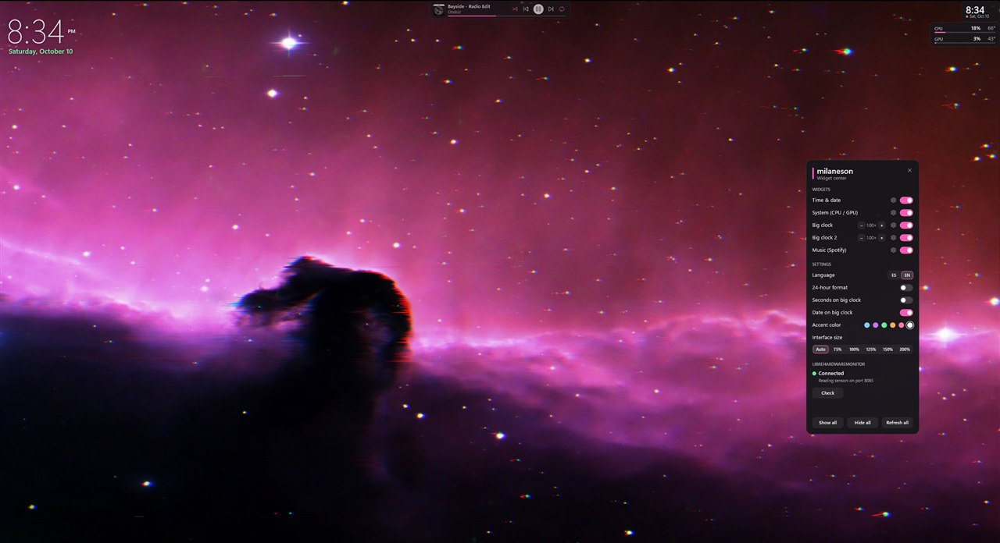
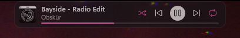
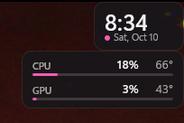
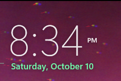
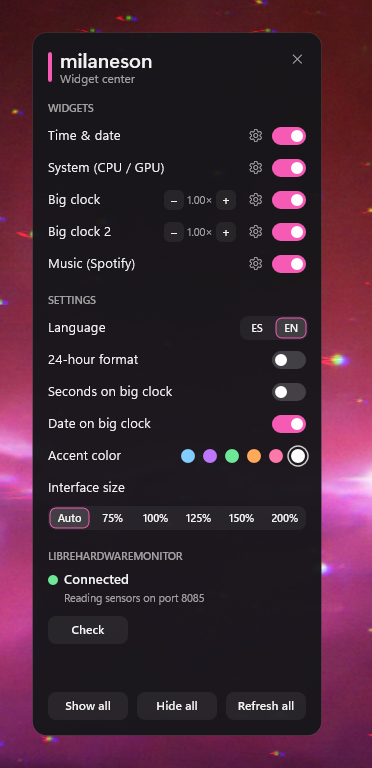
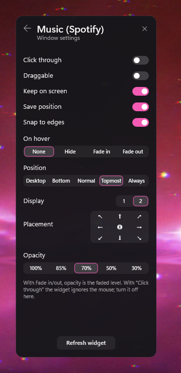

<div align="center">

# milaneson

**Widgets minimalistas para Rainmeter que se adaptan a tu fondo de pantalla, incluso los animados.**




<sub>Todos los colores de esta captura salieron solos del fondo de pantalla.</sub>

</div>

---

## ✨ Qué tiene

- 🎨 **Acento adaptativo:** toma el color dominante de tu fondo de pantalla, también de fondos animados de **Wallpaper Engine** o Lively, y lo aplica en vivo a toda la suite. Los relojes grandes, que van directamente sobre el fondo, usan un color que contrasta con él para que siempre se lean.
- 📐 **Escala automática:** se ajusta a la resolución de cada monitor: 1080p, 1440p, 4K o ultrawide. También puedes fijar el tamaño a mano.
- 🧭 **Un Hub para todo:** activa los widgets, cambia ajustes e idioma, y controla la ventana de cada widget sin tocar el menú de Rainmeter.
- 🌐 **Español e inglés**, con fechas en el idioma elegido.
- 🩺 **Detecta LibreHardwareMonitor:** te dice si está instalado, abierto y bien configurado, y te ayuda a arreglarlo.
- 🪶 **Ligero:** iconos y fuentes nativas de Windows 11, sin imágenes de relleno.

## 🧩 Widgets

<table>
<tr>
<td width="50%" valign="top">

### Música
Portada, canción, artista, controles y barra de progreso. Rueda del ratón para el volumen y clic derecho para silenciar. Sin música, se convierte en un botón para abrir Spotify.



</td>
<td width="50%" valign="top">

### Hora y fecha + Sistema
Reloj compacto y uso y temperatura de **CPU y GPU** con barras de carga. Lee los datos de LibreHardwareMonitor; funciona con Ryzen e Intel.



</td>
</tr>
<tr>
<td width="50%" valign="top">

### Reloj grande
Hora grande con fecha, segundos y a. m./p. m. opcionales. Hay dos instancias, para que puedas poner uno en cada monitor, y cada una tiene su propio tamaño.



</td>
<td width="50%" valign="top">

### Acento adaptativo
Un servicio invisible que lee tu fondo cada pocos segundos (~2 % de un núcleo) y solo actualiza cuando el color cambia de forma notable. Con un color fijo se apaga solo.

</td>
</tr>
</table>

## 🧭 El Hub

<table>
<tr>
<td align="center" width="50%"></td>
<td align="center" width="50%"></td>
</tr>
<tr>
<td valign="top">

**Página principal**
- Encender y apagar cada widget
- Tamaño de los relojes grandes (− / +)
- Idioma, formato de 24 h, segundos y fecha
- Color de acento: 5 fijos o **adaptativo**
- Tamaño de la interfaz: Auto, 75 %…200 %
- Estado de LibreHardwareMonitor

</td>
<td valign="top">

**Ajustes de ventana** (⚙ en cada widget)
- Clic a través, arrastrable, mantener en pantalla, guardar posición, ajustar a bordes
- Al pasar el ratón: ocultar, aparecer o atenuar
- Capa: escritorio, abajo, normal, encima o siempre encima
- Monitor y **ubicación rápida en 9 posiciones**
- Opacidad

</td>
</tr>
</table>

Abre el Hub en cualquier momento con **clic derecho en un widget → Abrir Hub**.

## 📦 Instalación

1. Instala [Rainmeter](https://www.rainmeter.net/) 4.5 o superior.
2. Consigue el instalador `milaneson_<versión>.rmskin`: descárgalo de [Releases](../../releases) o genéralo tú mismo (ver la sección *Desarrollo*).
3. Ábrelo con doble clic y pulsa **Install**. El Hub se abre al terminar.

El instalador incluye el plugin **WebNowPlaying**. Tus ajustes se conservan cuando actualizas a una versión nueva.

### Requisitos por widget

| Widget | Necesita |
|---|---|
| Sistema (CPU / GPU) | [LibreHardwareMonitor](https://github.com/LibreHardwareMonitor/LibreHardwareMonitor/releases) abierto como administrador y con **Options → Remote Web Server → Run** activado (puerto 8085 por defecto). El Hub detecta si falta algo. |
| Música | Un reproductor compatible con WebNowPlaying, como Spotify. El plugin viene incluido. |
| Acento adaptativo | Nada extra. Funciona con fondos estáticos, Wallpaper Engine y Lively. |
| Iconos | Windows 11 (fuente *Segoe Fluent Icons*). |

## 🛠️ Desarrollo

```
milaneson/            ← la skin (Hub, Clock, System, BigClock, BigClock2, Music, Adaptive)
  @Resources/
    Theme.inc         sistema de diseño: colores, fuentes, paleta de acentos
    Scale.inc         escala de la interfaz según la resolución
    Settings.inc      preferencias que escribe el Hub
    Lang/             textos en es / en
    Scripts/          Window.lua (ajustes de ventana), Adaptive.ps1 (acento), CheckLHM.ps1
installer/            RMSKIN.ini y plugins que incluye el .rmskin
build.ps1             genera dist/milaneson_<versión>.rmskin
sync.ps1              copia la skin a Documents\Rainmeter\Skins y la recarga
```

- **Probar cambios:** `powershell -ExecutionPolicy Bypass -File .\sync.ps1`. Respeta tus ajustes y solo agrega claves nuevas.
- **Generar el instalador:** `powershell -ExecutionPolicy Bypass -File .\build.ps1`. La versión sale de `installer/RMSKIN.ini`.
- **Codificación:** Rainmeter necesita los `.ini` y `.inc` en UTF-16 LE. El `.gitattributes` hace que git los guarde en UTF-8 (diffs legibles) y los devuelva en UTF-16 al clonar.
- **Escala:** todo valor en píxeles se escribe como `(N*#S#)`. Los multiplicadores y divisores (`#RowH#*2`, `/6`) no se escalan.

<details>
<summary><b>English</b></summary>

**milaneson** is a minimal Rainmeter suite: a central Hub, a compact clock, a CPU/GPU monitor (LibreHardwareMonitor), two big clocks and a music card (WebNowPlaying).

- **Adaptive accent** taken from your wallpaper, including animated Wallpaper Engine / Lively wallpapers. The big clocks get a contrasting color.
- **Auto scaling** per monitor resolution (1080p → 75 %, 1440p → 100 %, 4K → 150 %), or a fixed size.
- **Hub** to toggle widgets, change settings and language, and control each widget's window: click-through, hover fade, layer, monitor, 9-point placement and opacity.
- **Spanish and English** UI.

Install: get `milaneson_<version>.rmskin` (Releases or `build.ps1`), double-click it and press **Install**. The System widget needs LibreHardwareMonitor running as administrator with *Remote Web Server* enabled.

</details>
